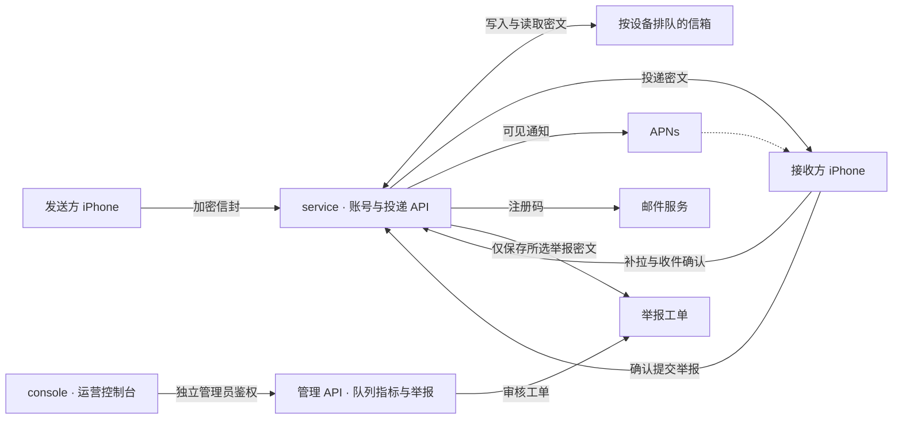

# SecretChat 安全即时通信 App 方案

> 面向海外小众社群 · 邮箱注册 · 邀请制 · 默认端到端加密
>
> 文档版本 v1.3 · 2026-11-24 · 服务端与控制台联调

## 1. 项目定位

首版面向已有私聊需求、双方都使用 iPhone 的联系人。正式模式通过邮箱验证码和邀请注册，当前开发模式凭邀请及自选测试标识注册。用户用邀请链接添加联系人，在一台设备上进行一对一文字聊天。私聊内容在两端加解密，服务端承担账号验证、公钥目录和离线投递。用户可以核对联系人的身份、设置消息保留时间、请求对方设备撤回自己发出的消息。

产品和服务端自行开发，会话协议复用 libsignal。首版以两项结果判断是否值得扩大内测：受邀者能否顺利完成首次对话，以及原本就需要私聊的双方在第二周是否继续使用。内测反馈由用户自愿提供，运营指标使用汇总数据。

## 2. 市场与竞品

| 产品 | 与本项目有关的差异 |
|---|---|
| Signal | 仍需手机号注册，可以用用户名建立联系并控制号码的可见性。需验证的需求是“注册时也无需交出手机号”。[Signal 用户名与号码隐私](https://signal.org/blog/phone-number-privacy-usernames/) |
| Threema、SimpleX、Session | Threema 使用随机 ID，SimpleX 没有全局用户 ID，Session 使用 Account ID。已有多种无手机号方案，内测应验证邮箱找回、邀请流程、销毁规则是否让目标用户愿意迁移。[Threema ID](https://threema.com/en/faq/threema-id) · [SimpleX](https://simplex.chat/) · [Session FAQ](https://getsession.org/faq) |
| WhatsApp、Telegram | WhatsApp 的个人聊天默认端到端加密。Telegram 区分云聊天和端到端加密的秘密聊天。SecretChat 为所有私聊提供同一加密模式。[WhatsApp 安全说明](https://www.whatsapp.com/security) · [Telegram FAQ](https://telegram.org/faq#q-how-secure-is-telegram) |

iMessage 是首批 iPhone 用户已有的私聊选择。企业微信、钉钉、飞书侧重组织协作，首版面向个人联系人。获客、成本和收入仍需内测验证。商业模式保留初期免费加自愿赞助，验证持续使用意愿后再评估买断或订阅。

## 3. 用户可见的功能与边界

| 功能 | 首版行为 |
|---|---|
| 一对一私聊 | 所有文字消息均使用 libsignal 端到端加密。联系人可通过安全码核验身份，换机后的信任规则见 §6。 |
| 消息撤回 | 发送者可以请求删除自己发出的消息。对方离线时显示“已请求撤回”；收到对方客户端的处理回执后显示“对方设备已处理”。回执只描述该客户端的处理结果。 |
| 定期销毁 | 会话或单条消息可以指定保留时长。界面在发送前说明本机与对方设备各从何时开始计时，具体规则见 §7。 |
| 拉黑与举报 | 用户可阻止后续联系，拉黑由服务端和客户端同时执行，规则见 §6。举报时在本机勾选、预览将提交的消息与账号信息，经确认后用运营公钥加密，单独提交给运营审核。举报内容是举报人单方提交的副本，没有密码学上的来源证明，按未经证实的陈述处理。 |
| 注销账号 | 用户可在应用内发起注销，确认后立即生效。服务端删除账号目录、登录凭据、推送绑定、拉黑关系和待投递信封，规则见 §6。客户端随即清除本机的消息库和密钥。 |

### 3.1 客户端内容防护

iOS 的普通截屏通知在截图完成后到达。客户端可事后提醒；录屏、镜像期间可根据场景捕获状态隐藏后续画面，切到后台时遮蔽 App 切换器快照。敏感气泡可禁用应用内复制，锁屏通知默认隐藏正文。对方仍可以用其他设备拍照，保存已经看到或复制的内容。[Apple 截屏通知](https://developer.apple.com/documentation/uikit/uiapplication/userdidtakescreenshotnotification) · [Apple 屏幕共享防护](https://developer.apple.com/documentation/swiftui/protecting-sensitive-content-when-screen-sharing)

后续 Android 版在敏感窗口使用 `FLAG_SECURE` 限制系统截屏和向非安全显示器输出。识别截屏事件需单独使用支持该能力的系统回调，并向用户说明可检测的范围。[Android 截屏控制与检测](https://developer.android.com/about/versions/14/features/screenshot-detection)

## 4. 首发地区与合规核实

海外是目标市场。公开分发前，按实际开发地、运营主体、实例及备份所在地域、目标用户所在地和商店分发地区，确认适用要求并记录结论。§5.2 的实例只用于开发联调，上线时改用另行选定的海外机器；选定后按同样维度重新确认适用要求。

- 中国商用密码进出口规定涉及具体清单与大众消费类产品条款。若在境内开发或向境外分发，需就软件及分发方式核对适用条款；开源许可和海外上架本身不足以确定结论。[《商用密码管理条例》第二条及第五章](https://www.mee.gov.cn/zcwj/gwywj/202305/t20230529_1031579.shtml)
- 确定首发国家后，逐一核对隐私、用户举报及删除请求的处理义务。英国需按服务类型、与英国的联系和适用例外评估范围；用户数量只是其中一个因素。[Ofcom 官方问答](https://www.ofcom.org.uk/siteassets/resources/documents/online-safety/information-for-industry/other/online-safety-act-explained-qa-web.pdf?v=409647)
- iOS 分发前完成 App Store Connect 的加密出口合规判断，按分发地区准备所需材料，并核对上架条款与客户端许可证。[Apple 加密出口合规](https://developer.apple.com/help/app-store-connect/manage-app-information/overview-of-export-compliance/)

## 5. 总体架构

### 5.1 组件与数据保留

| 目录 | 技术与职责 |
|---|---|
| `ios/` | SwiftUI + libsignal Swift 绑定，另含通知扩展（Notification Service Extension）。负责联系人核验、会话加解密、加密本地存储、重连与到期清理。 |
| `service/` | Java 17 + Spring Boot。提供邮箱和邀请码验证、设备公钥目录、密文信箱、收件确认、APNs 通知及独立鉴权的管理 API。不链接 libsignal，公钥材料按不透明字节存取，见 §8。 |
| `console/` | Web 运营控制台。查看队列深度、最老信封等待时间、邮件与推送失败情况，处理用户主动提交的举报，并记录管理员操作。 |
| `android/` | 后续 Kotlin 客户端。与 iOS 共用应用层信封格式、撤回语义和互操作用例。群组另行评估基于 RFC 9420 的 OpenMLS。[MLS 规范](https://www.rfc-editor.org/rfc/rfc9420.html) |

客户端只做 iOS 和 Android，不考虑 PC 端。

服务端已实现单设备账号、邀请及联系人、公钥目录、密文信箱、WebSocket 唤醒和加密举报。运营控制台提供登录、队列与供应商状态、邀请管理、工单审核和操作记录。JDK 17 可构建包含控制台的服务端 JAR。[本地启动、配置与测试](service/README.md) · [账号与公钥 API](service/directory-api.md) · [投递 API](service/mailbox-api.md) · [运营 API](service/operations-api.md)

普通消息的明文、身份私钥和棘轮状态只存在于端侧。双棘轮按消息派生密钥，删除旧密钥后，当前状态无法解开整段历史。控制台的内容审核入口只接收用户为某次举报主动提交的副本；副本在客户端用运营公钥加密，服务端只保存密文，审核人员在本机解密查看。管理员没有导入会话密钥、回放私聊或逐条浏览密文的接口。[Signal 双棘轮规范](https://signal.org/docs/specifications/doubleratchet/)

下表给出内测拟采用的保留期限。对外发布前按实际云配置、第三方服务和目标地区校准，并核实删除与恢复行为。

| 数据 | 服务端可见范围 | 保留与删除 |
|---|---|---|
| 账号与设备目录 | 邮箱、随机账号 ID、当前设备 ID、公钥和公开预密钥包、拉黑关系、邀请凭据及其兑换记录 | 账号存续期间保留有效映射。换机时撤掉旧设备的投递绑定；注销时清理账号映射、拉黑关系、邀请记录及待投递信封。一次性预密钥领取后即从可领取集合移除；客户端在余量不足时补充上传，用尽时新会话回退为仅用签名预密钥协商；服务端从备份恢复后清空全部未领取的一次性预密钥，等待客户端重新上传。 |
| 推送与邮件 | APNs 令牌、通知发送时间，以及只含固定文案和不透明信封引用的通知载荷；邮件服务收到收件邮箱和注册码 | 令牌在轮换、失效或注销时移除。验证码短时有效、单次使用；日志排除验证码与令牌。 |
| 离线信封 | 目标设备、信封 ID、入队和到期时间、密文大小及密文 | 开发默认最长保留 7 天。确认收件即删除，到期即停止投递并清理。队列存放在不启用备份的独立数据库中，与账号目录分开，并排除在长期日志和导出之外。 |
| 运行日志与备份 | 接入层可见来源 IP、时间和请求路径。应用仅记录排障所需的事件类型、状态码和耗时 | 开发默认排障日志 7 天轮转；关闭请求体、敏感头、令牌及路径参数记录。账号目录备份如启用，保留期拟为 7 天。注销与设备撤销记录以只追加方式写在账号目录库之外，保留期长于备份保留期；恢复备份后先完整重放这些记录，再清空未领取的一次性预密钥，然后才开放投递。无法完整重放时不用备份恢复。 |
| 举报与审计 | 举报人、被举报账号、提交时间和举报内容密文（明文仅在审核人员本机解密）；管理操作记录含操作者、工单号、动作和时间 | 分权访问。举报材料开发默认结案后 30 天清理；操作日志保留 30 天，仅记录处理动作。 |

### 5.2 阿里云开发联调环境

| 项目 | 配置与入口 |
|---|---|
| 主机 | 阿里云 Ubuntu 24.04，公网 IP `101.132.60.65`。运维通过 SSH 22 登录。 |
| 运营控制台 | [按 IP 打开控制台](https://101.132.60.65/secretchat/console/)。使用独立的运营账号。首次登录后进入“邀请管理”，选择“生成首个邀请码”。 |
| Nginx | 80 上的项目请求转到同路径 HTTPS。443 终止 TLS，将 `/secretchat/` 前缀去除后代理到 `127.0.0.1:8080`。项目使用 IP 自签证书，开发机使用已通过 SSH 核验的证书或专用浏览器启动器。 |
| 设备接口 | `/secretchat/api/…` 使用设备 Bearer 令牌，`/secretchat/ws` 使用相同令牌升级为 WebSocket。 |
| 运营接口 | `/secretchat/admin-api/…` 使用独立管理会话，写请求携带 CSRF 请求头。 |
| 后端 | Supervisor 的 `secretchat-service` 以 `secretchat` 系统用户运行。版本位于 `/opt/secretchat/releases/`，当前版本由 `/opt/secretchat/current` 指向。 |
| MySQL | 云机本地 MySQL。默认库 `secretchat_queue` 存放投递数据，`sc_directory`、`sc_ledger`、`sc_ops` 分别存放目录、撤销记录和运营数据。 |
| 已有 Web demo | `/login` 和 `/` 仍由原 Nginx 站点代理至 `127.0.0.1:8899`，Supervisor 进程名为 `webapp`。 |

**开发注册。** 当前环境设置 `SECRETCHAT_REGISTRATION_UNVERIFIED=true`。向 `POST /secretchat/api/accounts` 提交自选非空标识 `email`、一次性 `inviteCode` 和设备公钥即可注册，支持填写 `demo-alice` 等非邮箱格式的值。客户端保存响应中的设备令牌。首个用户可再签发邀请给第二个用户，后者注册后两人自动成为联系人。[请求字段和示例](service/directory-api.md)

**外部服务联调状态。** 邮件和 APNs 的协议适配器有本地模拟供应商测试。云机暂未配置发件凭据与 Apple 签名密钥，真实邮件送达、邮箱找回和 iPhone 锁屏通知待联调。找回账号始终要求有效的找回验证码。推送未配置期间，设备可通过 WebSocket 提示或主动补拉收件。运行概览显示当前注册模式及两项供应商状态。

本机私有配置和云机 `/etc/secretchat/service.env` 分别保管所需凭据。举报审核私钥由审核工作站保管，服务端仅配置公钥。客户端的 libsignal 会话、端侧销毁和真机验收见 §6–9。

## 6. 账号、设备身份与联系人规则

1. **注册与邀请。** 默认校验邮箱验证码和邀请凭据。§5.2 的开发模式仅校验邀请凭据。注册成功后，服务端分配随机账号 ID。邮箱仅用于验证和找回。邀请码与邀请链接是同一份凭据：由已注册用户在应用内生成，绑定邀请人账号，单次使用、可随时撤销，每个账号可同时持有的凭据数量由运营配置。未注册者凭它注册，已注册者凭它建立联系，两种情况下双方都互相成为联系人。服务端因此记录邀请人与受邀者的关联，仅用于名额控制、撤销和滥用排查，随账号注销删除。
2. **建立设备身份。** 每个账号只有一台活跃设备。使用所锁定 libsignal 版本的接口在本机生成身份及会话所需的密钥；上传公钥、签名预密钥和协议所需的公开预密钥材料，之后在一次性预密钥余量不足时补充上传。iOS 使用本设备专用的 Keychain 项保护本地密钥或数据库加密密钥，加密数据库保存会话状态。设计不假定 Secure Enclave 能直接生成或运算 libsignal 的 Curve25519 私钥。[Apple Secure Enclave 接口](https://developer.apple.com/documentation/cryptokit/secureenclave)
3. **核验联系人。** 首次联系展示未验证状态。双方可以当面扫码或通过已信任的独立渠道核对安全码。客户端在本地保存对方账号与设备身份公钥的绑定，公钥目录不能替用户完成核验。[Signal PQXDH 身份验证](https://signal.org/docs/specifications/pqxdh/#41-authentication)
4. **换机或找回。** 新设备生成新身份。服务端原子地撤销旧设备的登录凭据、推送及投递绑定，并清理发给旧设备的待投递信封。联系人看到身份变化提示，对此前已验证的联系人暂停发送，包括待重试消息，直到重新核验。邮箱找回只恢复账号使用权，首版无法恢复旧设备的本地聊天记录。
5. **拉黑。** 拉黑在服务端和客户端同时生效。服务端保存拉黑关系，对被拉黑账号发来的信封照常回复接收成功，但不入队、不投递，发送方因此看不出自己已被拉黑。客户端对已入队的此类信封直接确认并丢弃，不展示。解除拉黑后恢复投递，期间丢弃的信封不补发。服务端由此知晓拉黑关系。
6. **解密失败与会话重建。** 会话状态丢失、损坏或失步导致解密失败时，接收端不展示正文，记为“无法解密”并保留信封 ID，以免重复处理。随后由发现失败的一端取回对方新的预密钥包，建立新会话并发送加密的重建通知，对方收到后改用新会话。双方身份密钥不变，安全码不变，本机已有记录保留；故障期间的消息无法找回。本地保存的联系人绑定关系丢失时，相关联系人回到未验证状态。丢失的是身份密钥时，按“换机或找回”处理。
7. **注销。** 用户在应用内发起并确认。服务端在同一次事务里作废登录凭据、解除推送绑定、删除待投递信封和账号目录项，并把这次注销写入 §5.1 所述的撤销记录。客户端随即清除本机的消息库和密钥。注销不可撤销，之后发给该账号的信封被服务端拒收。

## 7. 消息投递、撤回与到期

### 7.1 投递与补拉

发送端生成稳定的消息 ID，将正文与销毁策略一同加密，在同一次本地事务中保存新的棘轮状态和待发信封，然后才把密文信封提交给服务端。这样中断后的重试只会重发同一份密文。重试沿用同一信封 ID 和原始到期时间。服务端按目标设备去重、入队。前台设备通过 WebSocket 获知新信封，启动、回前台和重连时主动补拉。App 在后台时的提醒见 §7.3。

接收端在同一次本地事务中保存协议状态、处理结果和补拉进度，成功后才确认收件。服务端收到确认后清理对应信封。若确认丢失，重复投递应得到相同处理结果。界面区分“服务端已接收”“对方设备已收到”“已读”和“已过期未送达”，每个状态都需要对应证据。信封在服务端到期时，服务端通过在线连接告知发送端；发送端重连时也会核对自己尚未确认的信封。

### 7.2 撤回与阅读计时

- **撤回。** 客户端发送加密撤回指令，携带会话和原消息 ID。接收端核验指令来自原发送者，删除正文、索引和应用内预览，保留只含标识的删除记录，覆盖原信封可能重投的整个期限。原文晚于撤回抵达或重复抵达时均不再展示。离线补拉先处理至本次同步开始时的队列末尾，再展示该批新消息，避免原文和撤回分处两页时短暂显示正文。
- **撤回回执。** 接收端完成本地删除事务后发送加密处理回执。对方长期离线导致指令过期，或客户端未回执，发送方保留“已请求撤回”的状态。已保存到应用外的副本仍由接收者控制。
- **阅后倒计时。** 首版发送端从发送成功时起算，接收端从首次打开该消息时起算，双方各自到期清理。持久化本机到期时刻；进程重启或回到前台时先清理再渲染。本地消息库、搜索索引和缓存一并清理，消息库及其密钥排除在可迁移备份之外。
- **信封 TTL。** 服务端以入队时确定的到期时刻限制离线投递。已经投递的消息由客户端执行其本地策略，队列到期不代表对方已经阅读或删除。

### 7.3 后台提醒

App 在后台时，服务端通过 APNs 发出一条可见通知，由系统负责展示，不依赖 App 被唤醒。载荷只含固定文案和一个不透明的信封引用，不含正文、发件人和收件账号。通知扩展收到后用设备凭据取回密文信封并解密，把通知改写为显示发件人；正文是否显示按 §3.1 的设置。改写失败或超过约 30 秒时，系统展示原来的固定文案。用户关闭通知权限时通知不再显示，开启专注模式时可能被隐藏，这两种情况只能等用户下次打开 App 补拉。[Apple 通知负载说明](https://developer.apple.com/documentation/usernotifications/generating-a-remote-notification) · [Apple 通知扩展说明](https://developer.apple.com/documentation/usernotifications/modifying-content-in-newly-delivered-notifications)

通知扩展只读取棘轮状态，不推进协议状态；解密出的展示内容写入独立的共享缓存，App 取回并处理该信封后再清掉缓存。会话状态因此只由 App 进程修改。扩展在锁屏时也要读取会话状态，所以保护消息库的钥匙串项设为首次解锁后可读、仅限本机；代价是设备开机首次解锁之后，锁屏状态下该密钥也在钥匙串的可读取范围内。若改为仅解锁时可读，锁屏期间一律显示固定文案，打开 App 后才能看到发件人。

服务端可以另发静默通知，请系统唤醒 App 预先补拉。这部分只用于加速，不承担提醒：系统不保证静默通知送达，数量多时会限流，Apple 建议每小时不超过两三条；用户强制退出 App 后，系统也不再自动拉起，要等用户再次打开。[Apple 后台推送说明](https://developer.apple.com/documentation/usernotifications/pushing-background-updates-to-your-app)

## 8. 上游协议与许可

客户端和服务端按本项目的身份与产品需求开发，协议实现直接使用 libsignal；只有客户端链接它，服务端把公钥材料当作不透明字节存储和转发，签名与有效性由客户端校验。上游明确表示不为 Signal 以外的使用提供支持，API 可能变动。原型阶段锁定版本和构建工具链，将建会话、乱序、重复投递、旧版本会话状态升级纳入回归；升级前用旧版生成的会话验证双向收发。后量子密钥协商按锁定版本与 PQXDH 等规范核实能力。[libsignal 官方仓库](https://github.com/signalapp/libsignal#readme) · [PQXDH 规范](https://signal.org/docs/specifications/pqxdh/)

iOS 和 Android 的依赖产物都由 Signal 的构建产物服务器发布。Swift 包的源码随 App 编译，Rust 库是预编译的 XCFramework，官方只提供 iOS 设备与模拟器两种版本，包与 XCFramework 的版本号必须一致。锁定版本时同时固定产物的校验和。macOS 没有官方预编译包，所以 iOS 回归用例在模拟器或真机上运行。[libsignal Swift 说明](https://github.com/signalapp/libsignal/tree/main/swift)

仓库当前根许可证为 Apache-2.0。计划在引入 libsignal 时给 `ios/` 和 `android/` 的客户端代码单独标注 AGPL-3.0，列明第三方组件许可；`service/`、`console/` 不链接 libsignal，自有代码计划沿用根许可证。libsignal 的著作权属于 Signal，AGPL 与应用商店条款是否兼容存在争议，所以分发方式和源码提供方式要在 P0 引入依赖之前确定并记录，不推迟到打包或上架前。[当前仓库许可证](LICENSE) · [libsignal 许可证](https://github.com/signalapp/libsignal/blob/main/LICENSE)

## 9. 原型验收

| 场景 | 通过条件 |
|---|---|
| 推送丢失、重复投递 | 在两台 iPhone 上关闭后台推送，接收方离线期间发消息。重新打开 App 后只显示一次；在本地提交后、收件确认前中断并重启，结果一致。 |
| 原文与撤回乱序 | 接收端离线时发送再撤回，覆盖撤回先到、重复、原文和撤回跨分页三种情况。重新上线不闪现正文，重启或重试也不恢复正文。 |
| 换机与邮箱找回 | 已核验联系人换机后旧设备不能再收取新信封，待发送消息暂停。独立核验新安全码后才能继续，历史明文不会随邮箱找回。 |
| 普通私聊保密 | 用已核验的两台设备发送专用测试文本，检查服务端数据库、日志、备份、推送载荷及控制台。除用户明确提交的举报副本外，均无测试明文与端侧私钥；队列中的密文无法用服务端持有的材料解密。 |
| 销毁与库升级 | 收件方始终离线时信封按 TTL 过期；本机倒计时跨重启仍生效。升级 libsignal 后，已有会话可继续收发，过期消息不重新出现。 |
| 后台提醒 | 接收端分别处于后台、锁屏、被用户强制退出三种状态时发送消息，三种状态都显示通知，并记录从发送到显示的延迟。扩展改写失败时显示固定文案。关闭通知权限后不再显示通知，打开 App 后仍能补齐消息。 |
| 解密失败与重建 | 人为损坏一端的会话状态后发送消息，接收端不出现明文。重建完成后恢复收发，安全码不变，故障期间的消息不被补出。 |
| 拉黑与注销 | 拉黑后对方继续发送，发送端只见“服务端已接收”，本端不出现消息和通知。注销后旧凭据立即失效，待投递信封和目录项被清除，从备份恢复后该账号不会重新出现。 |

## 10. MVP 路线图

| 阶段 | 范围与完成条件 |
|---|---|
| P0 原型（单人约 1 个月，估算） | 两台真机、一对一文字、最小投递服务与测试管理视图。首周先验证 libsignal 的 Swift 接入和 §9 的后台提醒，这两项的不确定性最高。以 §9 的验收结果决定何时进入邀请内测。 |
| P1 邀请内测（约 2～3 个月，估算） | 邮箱注册和找回、邀请码、身份核验、撤回和销毁、拉黑、举报和注销账号。功能在阿里云开发机完成全量联调，再部署到海外机器并重跑 §9 的验收，然后开始邀请内测。观察邀请完成率与次周持续对话的情况。 |
| P1.5 发布加固 | 固定发布依赖并验证可复现构建，完成针对身份、离线投递、数据保留和管理权限的独立安全审计。修复并复测发现的问题，发布审计范围与结论，再决定公开上线日期。 |
| P2 扩展 | 根据内测反馈给 Android、附件、群组排序。附件需要单独的密钥与过期清理；MLS 群组需要另行设计成员变更、设备验证和离线恢复。 |
| P3 增强 | 评估多设备、端到端加密迁移和进一步减少元数据的方案，分别定义恢复与撤销条件。 |
